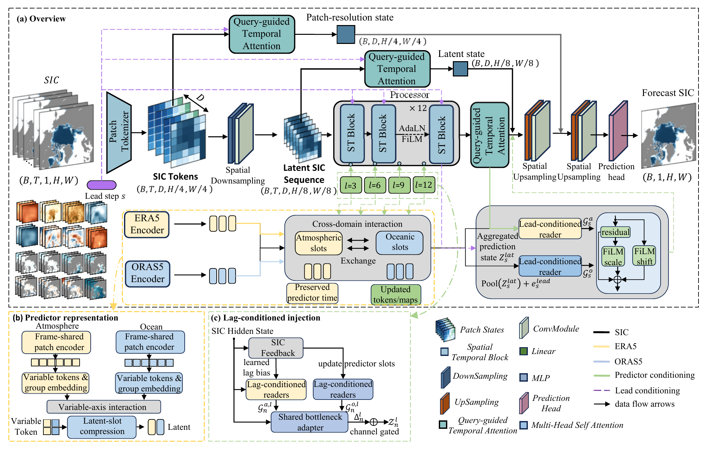
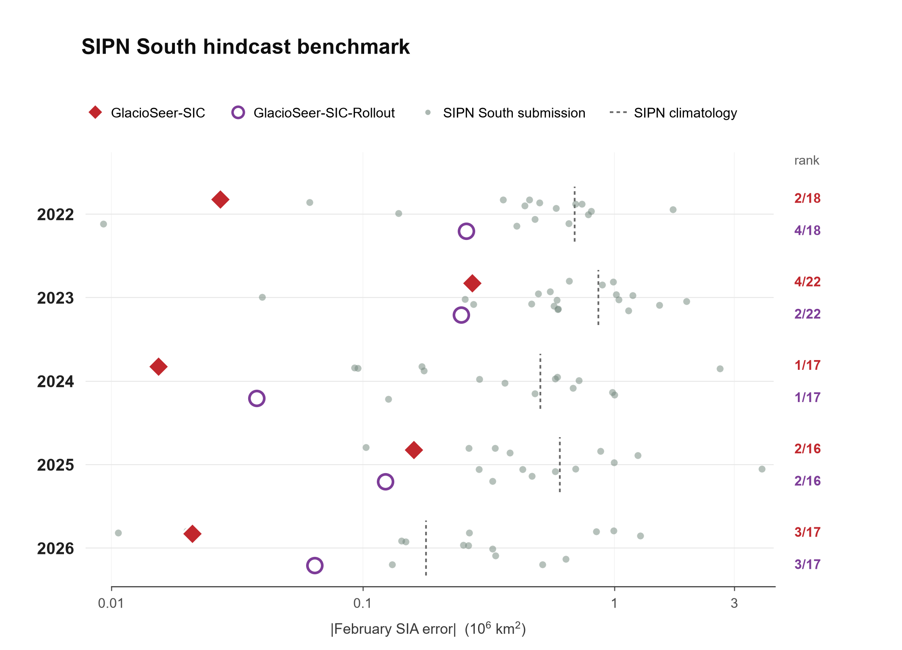
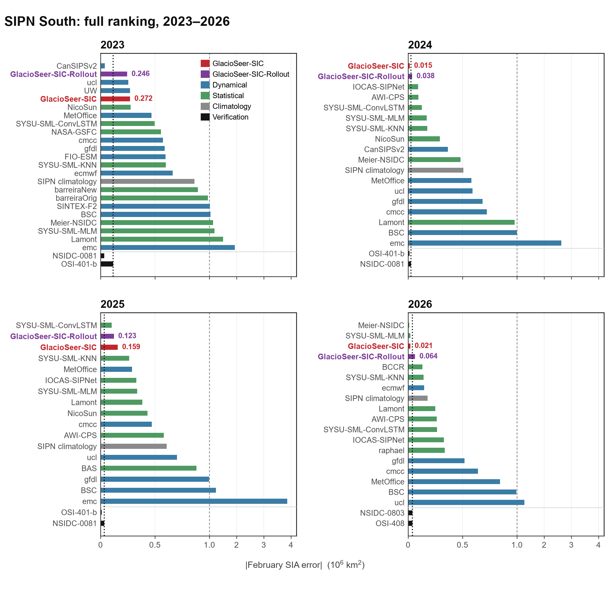

# GlacioSeer

**Lead-Time-Conditioned Seasonal Forecasting of Pan-Arctic Sea Ice Concentration With Atmospheric and Oceanic Histories**

> **Code release:** The GlacioSeer source code will be made publicly available at [github.com/yuweikong/GlacioSeer](https://github.com/yuweikong/GlacioSeer) upon acceptance of the manuscript. 

GlacioSeer is a data-driven framework for direct, lead-time-conditioned forecasts of monthly mean pan-Arctic sea-ice concentration (SIC), with forecast leads of one to six months.

An external benchmark against the archived SIPN South submissions of five Antarctic seasons is reported [below](#sipn-south-hindcast-benchmark).

## Model architecture

*Architecture of GlacioSeer-AO. The model combines the SIC forecasting backbone with separately encoded ERA5 atmospheric and ORAS5 oceanic histories.*

GlacioSeer has two configurations:

- **GlacioSeer-SIC** uses the preceding 12 monthly SIC fields. Lead conditioning guides its spatiotemporal processing and temporal readout.
- **GlacioSeer-AO** retains the SIC backbone and adds separate encoders for three-month ERA5 atmospheric and ORAS5 oceanic histories. Variable-axis interaction and latent-slot compression form compact predictor representations; cross-domain interaction and lag-conditioned injection connect them to the SIC pathway. Lead-conditioned readers and feature-wise linear modulation (FiLM) refine the forecast representation before decoding.

The shared network predicts each requested lead directly, without feeding an earlier predicted SIC field into the next forecast step. GlacioSeer-AO uses historical predictor fields and does not require future atmospheric or oceanic forecast fields.

## Reported evaluation

The manuscript evaluates monthly mean SIC with the spatial anomaly correlation coefficient (SACC), anomaly correlation coefficient (ACC), mean absolute error (MAE), and integrated ice-edge error (IIEE).

Under the fixed chronological split (training: 1979–2013; validation: 2014–2017; evaluation: 2018–2025), GlacioSeer-AO has higher SACC and ACC and lower MAE and IIEE than GlacioSeer-SIC at forecast leads 1, 2, 4, and 6. Among the methods compared under this split, it achieves the highest SACC at those four leads and ranks in the top two for every reported metric–lead pair. Rolling-origin results vary by lead and target season.

These are retrospective hindcasts using finalized SIC and reanalysis fields. The study does not evaluate whether those finalized inputs would have been available in real time at each nominal initialization date.

## SIPN South hindcast benchmark

**Both GlacioSeer configurations rank among the top four of every archived SIPN South season.**

SIPN South (Sea Ice Prediction Network – South) collects annual forecasts of the Antarctic February sea-ice area and archives every entry of a season, so the comparison with other groups can be made without re-running their models. We verified GlacioSeer-SIC against all five archived seasons, 2022–2026, together with **GlacioSeer-SIC-Rollout**, a recursive variant that applies the one-month-ahead model three times instead of predicting each lead directly.

*February sea-ice area error against the verifying analysis. Each row is one season; grey dots are individual SIPN South submissions, the dashed line is the SIPN climatology and the numbers on the right are the ranks of the two GlacioSeer products among the entries of that season. The horizontal axis is logarithmic.*

GlacioSeer-SIC ranks second, fourth, first, second and third of 16–22 entries, with an absolute error of 0.015–0.272 × 10⁶ km². In 2024 it is the closest entry of the panel, ahead of every dynamical and statistical submission, and its error is comparable to the 0.014 × 10⁶ km² that separates the two verification products. Its February error is 3 to 33 times smaller than the SIPN climatology in every season. The recursive variant trails it by 0.047 × 10⁶ km² on average and is the better of the two in 2023.

Full ranking of every submission, season by season

*Every forecast entry of the four most recent seasons, ordered by error. Beyond 1.0 × 10⁶ km² the axis is compressed so that the long tail cannot flatten the rest of the panel, and the dotted line marks the largest error among the verification products. Those two products sit below the rule because they are reference analyses, not forecasts. The 2022 season is included in the figure above and in [`data/sipn_south_feb_sia_ranking.csv`](data/sipn_south_feb_sia_ranking.csv); vector versions are in [`figures/sipn_south/`](figures/sipn_south).*

Forecasts start from a (Y−1) November origin and use twelve months of SIC; December, January and February are leads 1–3, and only February is compared, because several December and January entries reproduce the verifying analysis almost exactly. Truth is NSIDC-0051 v2 for 2022–2025 and the mean of NSIDC-0803 and OSI-408 for 2026, where NSIDC-0051 ends; ranks use the entries of the same season only, and the 2026 season is fully out of sample. The error table is in [`data/sipn_south_feb_sia_ranking.csv`](data/sipn_south_feb_sia_ranking.csv) and [`scripts/plot_sipn_south_ranking.py`](scripts/plot_sipn_south_ranking.py) reproduces every figure.

## Data sources

The study uses publicly available data; the datasets themselves are not included in this repository.

- Monthly SIC: [NOAA/NSIDC Climate Data Record of Passive Microwave Sea Ice Concentration, Version 6 (G02202)](https://doi.org/10.7265/b18j-z797).
- Atmospheric fields: [ERA5 monthly means from the Copernicus Climate Data Store](https://doi.org/10.24381/cds.f17050d7) and [pressure-level products](https://doi.org/10.24381/cds.6860a573).
- Ocean fields: [ORAS5 monthly ocean reanalysis](https://doi.org/10.24381/cds.67e8eeb7).
- External forecast comparison: selected retrospective Sea Ice Outlook submissions archived by the Sea Ice Prediction Network at [Zenodo](https://doi.org/10.5281/zenodo.10124346).

See the paper for data processing, input-variable definitions, and evaluation protocols.

## Citation

If you use GlacioSeer, please cite the accompanying paper. The final journal citation and DOI will be added here after publication.

## License

A license will be specified when the source code is released.
